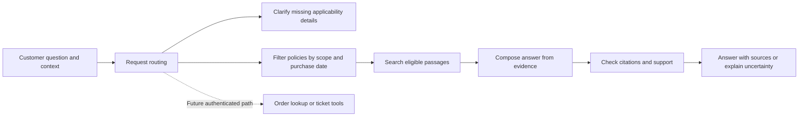

# Customer-support AI assistant

An AI engineering portfolio project for a fictional online store, developed through concept lessons, implementation, evaluation, and publication.

**Status: local web interface and HTTP API with policy retrieval and structured-answer validation.** Optional local Qwen inference is connected; embeddings, authentication and public deployment are not implemented. The earlier [shopping prototype](../shopping-assistant/README.md) demonstrates evidence handling separately.

## Intended capabilities and milestones

1. Policy retrieval and source-backed answers.
2. Order lookup and support-ticket drafting through validated tools.
3. Evaluation of retrieval, answer faithfulness, clarification and tool failures.
4. Backend, database, authentication, logs and a deployed interface.
5. Measured results, architecture documentation and a reproducible demonstration.

These are planned capabilities, not implementation claims. Latest measured milestone: frozen v10 wording evaluation scored 47/50 (94%); all 70 automated regression tests passed. The experimental model router remains opt-in.

## First milestone scope

Answer policy questions using applicable policy passages. Cite every policy claim. Ask for missing details when they affect policy applicability. Acknowledge absent or conflicting evidence.

Live order status requires an authenticated order-lookup tool; a policy document cannot answer it. Until that tool exists, explain the limitation. Refund execution is outside scope; policy explanation must not promise refund approval.

| Question | Expected behavior |
| --- | --- |
| How long do I have to return an item? | Determine applicable policy and cite the return window |
| Can I return something used? | Retrieve condition requirements and cite them |
| Where is my order? | Explain that live lookup is not yet connected |
| Can you guarantee my refund? | Explain the limits of policy advice; do not guarantee approval |
| Does the policy cover an undocumented exception? | State that evidence is insufficient |

## Proposed architecture



The model communicates and interprets evidence; authoritative policy rules remain in versioned documents. This permits updates without retraining and makes answers traceable.

See [policy-versioning.md](policy-versioning.md) for the first design decision and [evaluation-cases.json](evaluation-cases.json) for acceptance cases. All policy data is fictional.

## Run the baseline

Requires Python 3.9+; no packages or API keys. From this directory:

```sh
python3 support.py "How long do I have to return these shoes?" --purchase-date 2026-10-25 --country US --category footwear
python3 support.py "How long do I have to return these shoes?" --purchase-date 2026-11-01 --country US --category footwear
python3 support.py "Can I return used shoes?" --purchase-date 2026-11-02 --country US --category footwear
python3 -m unittest -v
```

The first two examples return 30-day and 14-day windows respectively, measured after delivery, with the correct version and passage citation. Missing purchase date or scope prompts clarification. Unmatched scope or absent exception evidence produces an insufficient-evidence response. Overlapping eligible policy versions produce a conflict rather than a guessed answer.

## Verification and limits

The original twelve retrieval test methods pass, including nine acceptance-case subtests plus boundary dates, invalid dates, missing context, conflicting versions and citation integrity. The CLI was also exercised directly. These small synthetic checks establish baseline behavior only, not production reliability.

Routing is conservative keyword matching and passage selection uses explicit window/condition labels; this is not semantic search or an AI-generated answer. Multi-intent questions and arbitrary paraphrases are not reliably supported. Responses quote authoritative fixture passages, preserving their source identity. Exact deadline calculation is deliberately deferred until store cutoff and timezone rules are defined, even when delivery date is supplied. Order tools, authentication and deployment remain future work.

**Why start here?** Separating policy applicability from model behavior gives us a reproducible baseline. A future retrieval or generation model must preserve these rules and outperform the baseline on a broader evaluation set.

## Web interface, API and validation milestone

Run `python3 api.py --port 8766` from this directory, then open the printed local address. If that port is occupied, use `--port 0` to select an available port. Use the form to compare October, November and missing-purchase-date cases. GET requests display the form; submitted questions use POST /api/answer.

Run `python3 -m unittest -v`: all 36 test methods passed, including 11 HTTP methods and the original acceptance-case subtests. The interface was also checked in a browser for the older policy, newer policy and missing-context flows.

The validator checks a proposed return-window claim's policy identity, citation, integer duration and starting event against retrieved structured facts. It emits controlled wording when matched and otherwise preserves the verified passage. It does not certify arbitrary generated prose. The API defaults to retrieved passages; local test callbacks exercise a future generator path, but the default mode remains deterministic. Clients cannot submit proposed facts to override the backend.

See [API.md](API.md) for the request contract and development-server limitations. The web/API/validation code is a runnable milestone, not a production-ready or fully AI-powered application. The local Qwen adapter now provides an optional extraction path. A broader evaluation set is the next milestone.

## Local Qwen milestone

The project now supports the installed `qwen2.5:1.5b-instruct` model through Ollama. To enable it:

```sh
python3 api.py --port 0 --local-model
```

Open the printed local address. The adapter uses only the fixed Ollama loopback endpoint. It extracts structured return-window facts from selected passage text; the backend validates them before rendering controlled wording. Unsupported claim types bypass model extraction; model failures fall back to the verified passage. Policy selection and question routing remain deterministic. This is not yet semantic RAG or general conversational support.

All **40 automated test methods passed**. Live October and November policy examples passed validation through the browser. These smoke checks are not evidence of broad model accuracy. See [LOCAL_MODEL.md](LOCAL_MODEL.md) for limits and observed timings. Model weights are not included in this repository.

## Experimental intent-routing milestone

A local Qwen request classifier is available only by explicitly starting the API with `--local-model --model-router`. The regular app still uses its reviewed keyword route. Deterministic scope and deadline checks stop unsupported, ambiguous, and mixed requests before policy answering.

The 61-test suite passed during implementation. A 50-question wording holdout initially scored 43/50 and exposed an exact-calendar-deadline miss. After fixing that gap, the same set scored 44/50: unsupported questions routed to return answering **0/15**, mixed requests answered as one **0/10**, supported routes correct **15/15**, and unnecessary clarifications **0/13**. Because the first run informed the fix, the rerun is regression evidence, not an independent promotion benchmark. The router remains experimental and does not replace default routing. See [REASSESSMENT.md](REASSESSMENT.md), [PROMOTION_CRITERIA.md](PROMOTION_CRITERIA.md), and [holdout-v3-final-results.json](holdout-v3-final-results.json).


## Latest classifier evaluation v10

The experimental local Qwen router scored **47/50 exact expected outcomes (94%)** on a frozen, developer-authored set. Unsupported questions routed to return answers: **0/15**. Mixed requests answered as only one part: **0/10**. Supported routing: **14/15 (93.3%)**; unnecessary clarifications: **1/12 (8.3%)**; ambiguous questions clarified: **10/10**. The automated Python suite passed **70/70** tests.

The numeric prototype gate passed, but the classifier remains opt-in. One product-use plus return question was safely refused as unsupported instead of prompting the shopper to split it. This was one small local-model run on a developer-authored set, so it is exploratory evidence, not proof of production reliability. The next evaluation should use fresh mixed product-use and return examples reviewed by someone outside the prompt-writing process.

- [Frozen v10 cases](holdout-v10-cases.json)
- [Recorded v10 results](holdout-v10-results.json)
- [Promotion criteria and decision history](PROMOTION_CRITERIA.md)
- [Audience project report](reports/project-brief.md)
- [Evaluation dashboard](reports/dashboard.html)
