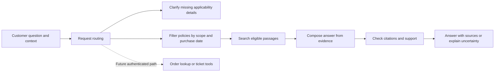

# Customer-support AI assistant

An AI engineering portfolio project for a fictional online store, developed through concept lessons, implementation, evaluation, and publication.

**Status: local web interface and HTTP API with policy retrieval and structured-answer validation.** No LLM, embeddings, authentication or public deployment is connected yet. The earlier [shopping prototype](../shopping-assistant/README.md) demonstrates evidence handling separately.

## Intended capabilities and milestones

1. Policy retrieval and source-backed answers.
2. Order lookup and support-ticket drafting through validated tools.
3. Evaluation of retrieval, answer faithfulness, clarification and tool failures.
4. Backend, database, authentication, logs and a deployed interface.
5. Measured results, architecture documentation and a reproducible demonstration.

These are planned capabilities, not implementation claims. No quality or latency results have been measured yet.

## First milestone scope

Answer policy questions using applicable policy passages. Cite every policy claim. Ask for missing details when they affect policy applicability. Acknowledge absent or conflicting evidence.

Live order status requires an authenticated order-lookup tool; a policy document cannot answer it. Until that tool exists, explain the limitation. Refund execution is outside scope; policy explanation must not promise refund approval.

| Question | Expected behavior |
| --- | --- |
| How long do I have to return an item? | Determine applicable policy and cite the return window |
| Can I return something used? | Retrieve condition requirements and cite them |
| Where is my order? | Explain that live lookup is not yet connected |
| Can you guarantee my refund? | Explain the limits of policy advice; do not guarantee approval |
| Does the policy cover an undocumented exception? | State that evidence is insufficient |

## Proposed architecture



The model communicates and interprets evidence; authoritative policy rules remain in versioned documents. This permits updates without retraining and makes answers traceable.

See [policy-versioning.md](policy-versioning.md) for the first design decision and [evaluation-cases.json](evaluation-cases.json) for acceptance cases. All policy data is fictional.

## Run the baseline

Requires Python 3.9+; no packages or API keys. From this directory:

```sh
python3 support.py "How long do I have to return these shoes?" --purchase-date 2026-10-25 --country US --category footwear
python3 support.py "How long do I have to return these shoes?" --purchase-date 2026-11-01 --country US --category footwear
python3 support.py "Can I return used shoes?" --purchase-date 2026-11-02 --country US --category footwear
python3 -m unittest -v
```

The first two examples return 30-day and 14-day windows respectively, measured after delivery, with the correct version and passage citation. Missing purchase date or scope prompts clarification. Unmatched scope or absent exception evidence produces an insufficient-evidence response. Overlapping eligible policy versions produce a conflict rather than a guessed answer.

## Verification and limits

The original twelve retrieval test methods pass, including nine acceptance-case subtests plus boundary dates, invalid dates, missing context, conflicting versions and citation integrity. The CLI was also exercised directly. These small synthetic checks establish baseline behavior only, not production reliability.

Routing is conservative keyword matching and passage selection uses explicit window/condition labels; this is not semantic search or an AI-generated answer. Multi-intent questions and arbitrary paraphrases are not reliably supported. Responses quote authoritative fixture passages, preserving their source identity. Exact deadline calculation is deliberately deferred until store cutoff and timezone rules are defined, even when delivery date is supplied. Order tools, authentication and deployment remain future work.

**Why start here?** Separating policy applicability from model behavior gives us a reproducible baseline. A future retrieval or generation model must preserve these rules and outperform the baseline on a broader evaluation set.

## Web interface, API and validation milestone

Run `python3 api.py --port 8766` from this directory, then open the printed local address. If that port is occupied, use `--port 0` to select an available port. Use the form to compare October, November and missing-purchase-date cases. GET requests display the form; submitted questions use POST /api/answer.

Run `python3 -m unittest -v`: all 36 test methods passed, including 11 HTTP methods and the original acceptance-case subtests. The interface was also checked in a browser for the older policy, newer policy and missing-context flows.

The validator checks a proposed return-window claim's policy identity, citation, integer duration and starting event against retrieved structured facts. It emits controlled wording when matched and otherwise preserves the verified passage. It does not certify arbitrary generated prose. The API defaults to retrieved passages; local test callbacks exercise a future generator path, but no model is connected. Clients cannot submit proposed facts to override the backend.

See [API.md](API.md) for the request contract and development-server limitations. The web/API/validation code is a runnable milestone, not a production-ready or fully AI-powered application. The next milestone is a provider and budget decision followed by model integration evaluated against this baseline.
