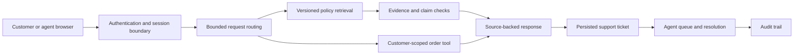

# Customer Support AI Platform

An end-to-end AI engineering portfolio project for a fictional online store. It combines the evaluated policy-routing work with the product capabilities needed to complete a customer-support case:

- authenticated customer accounts with PBKDF2 password hashing and expiring bearer sessions;
- customer-scoped order lookup backed by SQLite;
- source-backed return-policy answers with explicit version selection and safe clarification;
- persisted support tickets with priorities, order links, and agent-only resolution;
- an agent browser workspace and auditable resolution trail;
- a responsive browser interface;
- a Docker image and Compose file for a repeatable deployment.

All customer, order, and policy data in the seeded demo is fictional. The policy engine remains deliberately bounded: it does not promise refund approval, invent an exact deadline, or expose another user's order. The previously evaluated local-model router remains an optional experimental component; authoritative policy selection and tool authorization stay deterministic.

## Product architecture



The key design decision is separation of authority. A language model may help interpret wording, but it cannot create order status, approve refunds, select another customer's data, or override policy applicability.

## Run locally

From this directory:

```sh
python3 app.py --port 8766
```

Open <http://127.0.0.1:8766>. The seeded customer account is `demo@example.com` with password `demo-password-123`; the agent account is `agent@example.com` with password `agent-password-123`.

The SQLite path can be changed with `--db` or `DATABASE_PATH`. Set `SEED_DEMO=0` and use `--no-seed` when creating a clean database for a real integration.

## Run with Docker

```sh
docker compose up --build
```

The database is stored in the named `support-data` volume. Put a TLS reverse proxy and an external secret/session strategy in front of the service before exposing it publicly; the included server is a compact application reference, not a finished compliance boundary.

## API surface

`POST /api/auth/register` and `POST /api/auth/login` return a bearer token. Send it as `Authorization: Bearer <token>` to call authenticated endpoints:

- `GET /api/me` — current account;
- `GET /api/orders` or `GET /api/orders?id=order-1001` — only the current user's orders;
- `POST /api/policy/answer` — answer a bounded policy question from versioned evidence;
- `GET /api/tickets` — customer tickets, or the complete queue for an agent;
- `POST /api/tickets` — create a ticket, optionally linked to an owned order;
- `PATCH /api/tickets/<id>` — resolve a ticket as an agent.
- `GET /api/audit` — inspect ticket lifecycle events as an agent.

`GET /health` is intentionally unauthenticated for container health checks.

## Verification

```sh
python3 -m unittest discover -s tests -v
python3 evaluate.py --output reports/evaluation-results.json
```

The checks cover password/session behavior, customer scoping, policy-version boundaries, safe deadline handling, ticket creation, agent-only resolution, audit access, and safe browser rendering of stored customer text. The evaluator records the complete customer-to-agent product flow by category.

## Portfolio materials

- `reports/portfolio-report.md` explains the problem, architecture, challenges, evidence, and limitations.
- `reports/evaluation-dashboard.html` presents the measured milestone in a browser.
- `reports/evaluation-results.json` contains the reproducible case-level outcomes.

## Next production steps

Use a managed database, rotate signing/session secrets, add rate limiting and structured logs, put the service behind HTTPS, replace the demo policy fixture with a reviewed policy ingestion pipeline, and add an independent evaluation set for the optional model router. The model must remain subordinate to policy applicability and fact validation.
