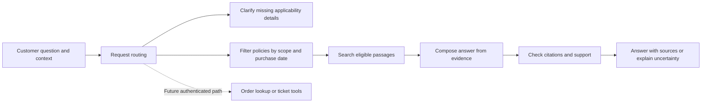

# Customer-support AI assistant

An AI engineering portfolio project for a fictional online store, developed through concept lessons, implementation, evaluation, and publication.

**Status: design milestone.** This folder contains the agreed project brief, architecture decisions, fictional policy fixtures and evaluation cases. It does not yet contain a running support assistant, model integration or deployment. The earlier [shopping prototype](../shopping-assistant/README.md) demonstrates evidence handling separately.

## Intended capabilities and milestones

1. Policy retrieval and source-backed answers.
2. Order lookup and support-ticket drafting through validated tools.
3. Evaluation of retrieval, answer faithfulness, clarification and tool failures.
4. Backend, database, authentication, logs and a deployed interface.
5. Measured results, architecture documentation and a reproducible demonstration.

These are planned capabilities, not implementation claims. No quality or latency results have been measured yet.

## First milestone scope

Answer policy questions using applicable policy passages. Cite every policy claim. Ask for missing details when they affect policy applicability. Acknowledge absent or conflicting evidence.

Live order status requires an authenticated order-lookup tool; a policy document cannot answer it. Until that tool exists, explain the limitation. Refund execution is outside scope; policy explanation must not promise refund approval.

| Question | Expected behavior |
| --- | --- |
| How long do I have to return an item? | Determine applicable policy and cite the return window |
| Can I return something used? | Retrieve condition requirements and cite them |
| Where is my order? | Explain that live lookup is not yet connected |
| Can you guarantee my refund? | Explain the limits of policy advice; do not guarantee approval |
| Does the policy cover an undocumented exception? | State that evidence is insufficient |

## Proposed architecture

The model communicates and interprets evidence; authoritative policy rules remain in versioned documents. This permits updates without retraining and makes answers traceable.

See [policy-versioning.md](policy-versioning.md) for the first design decision and [evaluation-cases.json](evaluation-cases.json) for planned acceptance cases. All policy data is fictional.
