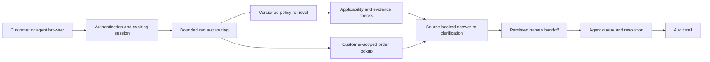

# Customer Support AI Platform

## Portfolio project report

### Executive summary

I built an end-to-end customer-support platform for a fictional online store. The product connects grounded policy assistance with authenticated order lookup, a persisted human-handoff workflow, an agent resolution queue, and an audit trail. The main engineering decision is that language understanding is advisory while business authority remains deterministic: policy applicability, customer data access, refund limits, and agent permissions are enforced by application code and stored data.

The completed local milestone passed seven automated tests and 20 of 20 recorded product-flow evaluation cases. Those results show that the implemented scenarios behave as designed. They do not establish production security, availability, compliance, or real-world model accuracy.

### Problem and product goal

Customer-support assistants often fail in two different ways. They may produce a fluent answer without the evidence needed to support it, or they may expose or invent operational data that should come only from an authenticated system. This project addresses both risks in one reviewable product.

The customer can sign in, inspect their orders, ask a bounded return-policy question, and open a ticket linked to an owned order. A support agent has a separate queue and can resolve tickets with a recorded note. The product does not execute refunds or expose a customer's order based only on a natural-language request.

### Architecture

The application is intentionally small and uses Python's standard library with SQLite. Passwords use PBKDF2 hashing, sessions are stored as token hashes with expiration, and every customer order query includes the authenticated user ID. The browser communicates with a JSON API. Docker and Compose provide a repeatable local deployment package.

### What was built

| Capability | Implementation | Boundary enforced |
| --- | --- | --- |
| Authentication | Account registration, password verification, expiring bearer sessions | Invalid credentials and unauthenticated access are rejected |
| Order lookup | SQLite-backed orders scoped by authenticated user ID | A customer cannot retrieve or link another customer's order |
| Policy assistance | Version selection by purchase date, country, and category | Missing applicability data triggers clarification |
| Evidence handling | Source, version, passage ID, and structured return facts | Undocumented exceptions and exact dates are not invented |
| Human handoff | Persisted tickets with order links and priority | Only an owned order can be attached |
| Agent workflow | Priority queue, resolution note, audit event | Only agent and admin roles can resolve or inspect audit events |
| Browser safety | Stored customer content rendered with DOM text nodes | Stored content is treated as data rather than executable HTML |
| Deployment | Docker image, persistent volume, health endpoint | The container exposes a repeatable application boundary |

### Challenges and engineering responses

**Policy versioning.** A return answer can be factually correct for one policy version and wrong for another. The selector uses purchase date and scope before returning evidence. If required context is absent, the assistant asks for it.

**Private operational data.** Order status cannot be inferred from policy documents or model memory. The order tool reads the authenticated account and applies the user ID to every lookup.

**Unsupported confidence.** The assistant refuses to guarantee a refund, does not calculate an exact calendar deadline without cutoff and timezone rules, and reports insufficient evidence for an undocumented defect exception.

**Human escalation.** A safe refusal alone is not a complete support experience. Tickets preserve the customer's message, optional order link, priority, status, and resolution note so an agent can continue the case.

**Two-sided workflow.** The initial browser exposed customer actions but no agent controls. The finished interface detects the account role and gives agents a priority queue with resolution actions.

**Stored customer text.** Ticket messages are untrusted. The initial browser assembled them with HTML strings. The completed interface creates DOM nodes and assigns text content, preventing stored markup from being interpreted as interface code.

### Evaluation evidence

The automated suite passed 7 of 7 tests. It covers customer and agent authentication, customer-scoped orders, policy-version selection, clarification behavior, ticket lifecycle, agent-only resolution, agent-only audit access, and the stored-text rendering boundary.

The product-flow evaluator passed 20 of 20 recorded cases:

| Evaluation group | Result |
| --- | ---: |
| Authentication | 2 of 2 |
| Order access and isolation | 3 of 3 |
| Policy behavior | 7 of 7 |
| Human handoff | 2 of 2 |
| Agent workflow | 2 of 2 |
| Authorization | 2 of 2 |
| Auditability | 1 of 1 |
| Browser safety | 1 of 1 |

The earlier experimental local-model router was evaluated separately on a frozen set of 50 wording cases. It produced 47 exact expected outcomes, no unsupported question routed to a return answer, and no mixed request answered as only one request. That result supports keeping model-based interpretation available as an experimental component, while the product's authoritative decisions remain deterministic.

### What the evidence does not prove

The application uses fictional users, orders, and policies. The 20-case evaluator calls local application functions rather than a hosted production environment. The model-routing evaluation was developer-authored and used one local model run. The evidence does not establish penetration-test coverage, regulatory compliance, production availability, accessibility conformance, or accuracy on real customer traffic.

### How to explain the project in an interview

> I built a complete customer-support AI platform rather than a chatbot demo. A model can help interpret the request, but authenticated tools and policy code control what the system is allowed to say and do. Customers can see only their own orders, policy answers show their source and version, uncertain cases move to a persisted human ticket, and agents resolve those tickets through a separate role-controlled workflow. I evaluated the current product across 20 end-to-end scenarios and kept the model router experimental because its separate wording evaluation was promising but not production evidence.

### Next production milestones

Use a managed database and external session store, rotate secrets, add rate limiting and structured telemetry, put the service behind HTTPS, connect a reviewed policy-ingestion pipeline, run accessibility and penetration testing, and evaluate the model router on independently authored customer language. Real refund execution should remain a separately authorized tool with its own approval and audit boundary.
